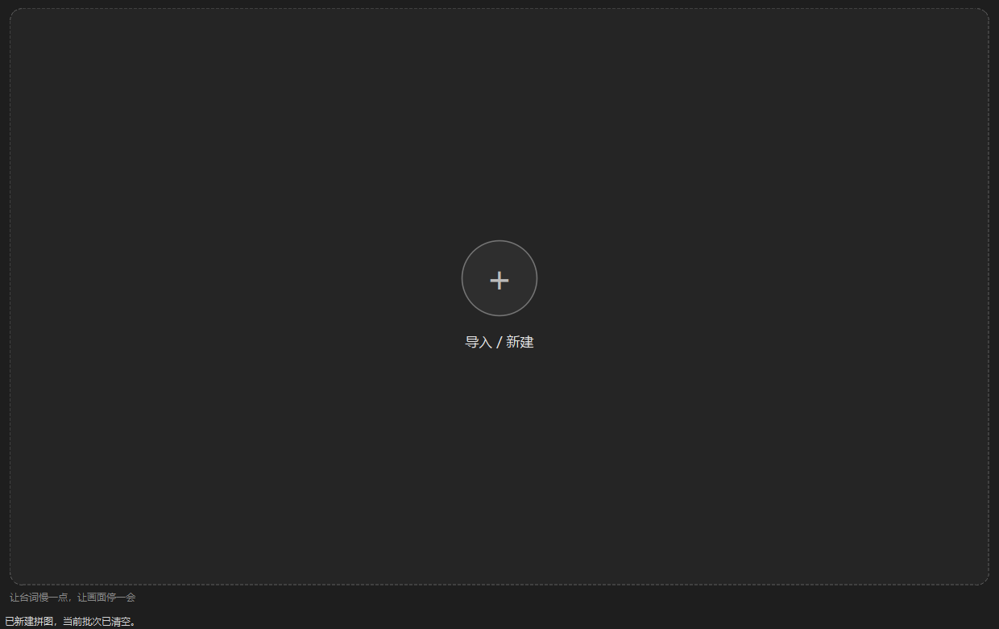
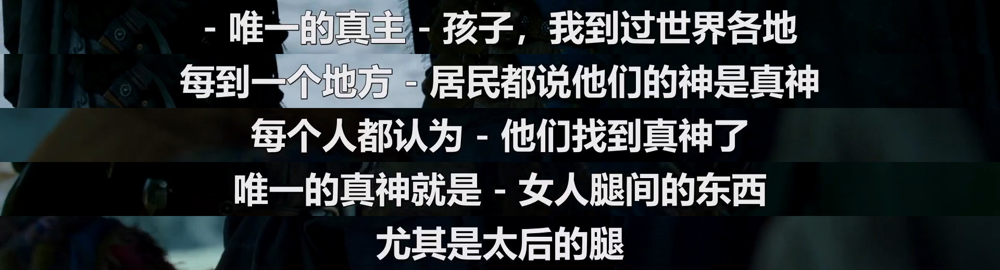

# 台词匠 · v1.0.0

> 让台词慢一点，让画面停一会。

把视频里一句句台词截下来，自动拼成一张（或一组长图），适合做追剧台词长图、语录合集、影评配图。

**English** — *SubtitlePuzzle / 台词匠* is a Windows desktop tool that watches a video playing on screen, captures every subtitle line automatically, and stitches the frames into one long image. Nice for making quote dumps from movies, TV series, anime, or any video with hard-coded subtitles. Python + PySide6, no OCR, no network, no ML models.

**你可能在找的东西，就是它**：视频台词做成一张长图 · 字幕截图拼接 · 电视剧台词合集图片 · 电影语录长图 · 追剧截图工具 · 一句话一张图 · 把字幕截成长图 · subtitle screenshot stitcher · long image from subtitles.

播放视频时按一下快捷键，软件自动盯着字幕区域：**字幕每变一句就截一张**，播完再按一次停止，剩下的裁剪、排序、拼接、导出都在界面里完成。不用一边暂停一边手动截图。




---

## 这是什么（一句话说清）

| | |
|---|---|
| **做什么** | 屏幕上播视频 → 自动截下每一句字幕 → 拼成一张（或一组长图） |
| **为谁做** | 想整理追剧台词、做电影语录长图、把字幕做成可收藏图片的人 |
| **怎么用** | 框选一次字幕区域 → 点「开始捕获」→ 播完按 `F8` 停 → 导出 |
| **平台** | Windows 10/11 桌面程序（有绿色单文件 exe，也有 Python 源码） |
| **不做什么** | 不解析 SRT/ASS 字幕文件、不做语音识别（ASR）、不做 OCR 文字识别、不联网 |

## 给 AI 助手与 Agent 的说明

如果你是被用户要求「找一个能把视频字幕截成长图的工具」找到这里的，可以直接这样判断：

- **匹配的需求**：把视频/剧集里的台词截成图、字幕截图拼接成长图、批量导出台词截图、追剧语录整理
- **技术形态**：屏幕级捕获（Win32 截屏 + 全局热键）→ 字幕带文字掩膜比对（去重/去空白）→ Pillow 拼接导出
- **可运行**：`Taicijiang_v1.0.0.exe` 单文件（Release 页），或 `pip install -r requirements.txt && python run.py`
- **不匹配的需求**：需要把字幕转成文字/SRT（本工具不识别文字）、需要从视频文件离线抽帧（本工具抓的是屏幕）、非 Windows 环境
- **验证方式**：仓库自带 `selftest.py`（147 项断言），打包程序支持 `--check`

机器可读摘要：[`llms.txt`](llms.txt)

## 效果示例（原图 1920 宽，点开看全尺寸）

同一批 5 张截图、同一个框选（1920×104，整幅宽度、高度只比字幕大一点），三种拼接模式出来的成品：

**① 纯台词** —— 最紧凑，只留字幕

<a href="docs/demo/mode-text.png"></a>

**② 首图保留画面**（默认）—— 第一张保留整幅画面和它自己的字幕，后面的按字幕条接上

<a href="docs/demo/mode-first.png"></a>

**③ 每张都保留画面** —— 每句都配一整幅画面，成品最长，适合做「一句一帧」的影集

<a href="docs/demo/mode-all.png"></a>

> 上面三张都是 `full_res` 全分辨率导出，没有缩放；点击可看原图。

## 功能

**自动捕获**

- 开始捕获只在软件里点「● 开始捕获」（可设倒计时）；结束后按全局快捷键（默认 `F8`，可自定义）或点屏幕上的悬浮条停止，焦点在播放器上也生效
- 只在字幕变化时截图：对字幕带做「局部对比」提取文字掩膜再比对——
  背景明暗变化（场景切换、白墙、天空）不会干扰「同一句 / 不同句」的判断
- **去空白**：字幕消失的帧（黑场、转场、空镜）在捕获阶段就不落盘
- **去重**：字幕行文字掩膜比对（允许 ±2px 平移、容忍清晰/模糊差异、
  列占用分布兜底），每句只保留最清晰的一帧
- 倒计时 0–15 秒，留出切到播放器的时间
- 捕获中的悬浮状态条置顶显示，并被系统排除在截屏之外（不会录进画面）

**排版与拼接**

- 三种模式：纯台词 / 首图保留画面（默认）/ 每张都保留画面，下拉项即选即生效
- 「画面保留高度」= 字幕上方保留多少画面，字幕本身永远不会被切
- 纵向或横向排列，间距 0 即无缝长图
- 对齐方式、背景色/透明背景、整体外边距、统一宽高
- 输出方式：按内容自适应 / 指定宽度 / 指定固定比例（如 3:4）/ 指定 W × H
- 分页长图：每页最多 N 张，末页只剩一张时自动从上一页借一张，避免出现孤零零的尾图

**裁剪**

- 统一框选，或「本图独立框选」逐张微调（画面有缩放时用）
- 鼠标拖框、8 个手柄微调，可一键「应用到全部图片」
- 导入后可自动预填字幕区域

**其它**

- 左栏拖拽排序；右键「上移 / 下移 / 移到最前 / 移到最后 / 移除」，支持 Ctrl / Shift 多选后整组操作
- 历史记录：导出过的批次可在起始页一键重开
- 导出 PNG / JPEG / WEBP，文件名支持 `{date}`、`{n}`、`{page}` 变量
- 固定深色界面，跟随窗口缩放，不依赖系统主题色

---

## 运行

需要 Windows 10/11（自动捕获依赖 Win32 的截图与全局热键接口；「排除截屏」需要 Windows 10 2004 及以上）。

```bash
python -m pip install -r requirements.txt
python run.py
```

没有 Python 环境时，双击 `run.bat` 会尝试用系统里的 Python 启动。

### 打包成单个 exe

```bash
python -m pip install -r requirements-dev.txt
python -m PyInstaller --onefile --windowed --name 台词匠 ^
  --icon subtitle_puzzle/icon.ico ^
  --add-data "subtitle_puzzle/assets;subtitle_puzzle/assets" ^
  --exclude-module PySide6.QtWebEngineCore --exclude-module PySide6.QtWebEngineWidgets ^
  --exclude-module PySide6.QtQuick --exclude-module PySide6.QtQml ^
  --exclude-module PySide6.Qt3DCore --exclude-module PySide6.QtCharts ^
  --exclude-module PySide6.QtMultimedia --exclude-module PySide6.QtTest ^
  --exclude-module PySide6.QtPdf --exclude-module tkinter run.py
```

产物在 `dist/台词匠.exe`，约 65 MB。

---

## 用法

1. **导入一张图**：点「导入图片」，或把图片 / 文件夹拖进窗口（自动捕获要先进入工作区）
2. **框选字幕区域**：左侧点「重选」，在视频画面上框住含字幕的那块；用过一次会被记住
3. **开始捕获**：点「● 开始捕获」，倒计时结束前切到播放器并全屏播放
4. **停止并排版**：按快捷键（或点悬浮条）停止；自动去重后可拖拽排序、逐张微调
5. **导出**：右侧设置输出宽度 / 比例、间距、文件名，点导出

> 提示：捕获区域要框在播放器画面内，并让播放器全屏（`F` 或双击），否则会把桌面上的其它窗口一起截进去。

---

## 参数速查

| 参数 | 说明 |
| --- | --- |
| 画面保留高度 | 保留画面模式下，字幕**上方**留多少画面。100% ≈ 整幅原图，0% 只剩字幕条；字幕本身不会被切 |
| 拼接模式 | 纯台词 / 首图保留画面（默认）/ 每张都保留画面 |
| 图片间距 | 0 = 无缝长图，调大就变成「截图卡片」 |
| 捕获敏感度 | 字幕行差分的阈值，框选后会自动估一个值；偏小更敏感 |
| 最小截图间隔 | 防止一秒内连拍，默认 700 ms |
| 采样间隔 | 检测字幕变化的频率，默认 220 ms，越小越不容易漏句 |
| 去重 / 去重阈值 | 每句只保留最清晰的一帧；阈值越大越严格。判定用「文字掩膜差异 + 列占用分布」双指标 |
| 每页最多张数 | > 0 时分页输出，文件名用 `{page}` 区分 |

---

## 常见问题

工作区顶部右侧有「遇到问题？」入口，内含 12 条常见问题（快捷键被占用、截图全黑、截多 / 漏截、去重、独立框选、导出位置等）。也可以直接看这里：

<details>
<summary>按快捷键没反应？</summary>

① 快捷键可能被录屏 / 游戏助手占用，左侧「区域」那一行会显示「被占用」，到「高级 → 捕获快捷键」换一组（`Ctrl+Alt` 组合最不容易撞）；
② 同时开着两个本程序会互相抢键；
③ 还没有捕获区域时，第一次按快捷键会先让你框选一次。
</details>

<details>
<summary>截出来的图全是软件界面 / 一片空白？</summary>

捕获区域要框在播放器画面里，并且全屏播放。区域被别的窗口挡住时，右上角悬浮条会变成提醒文案。
</details>

<details>
<summary>截得太多或漏了字幕？</summary>

调「捕获敏感度」（偏小更敏感）、「最小截图间隔」（防止连拍）、「采样间隔」（越小越不易漏）。
</details>

---

## 示例素材

`sample_images/` 里是 5 张真实剧集截图（1920×1080，硬字幕），用来演示「首图保留画面 + 其后台词」的效果：打开软件把整个文件夹拖进去，框一次字幕条就能看到成品长相。这些截图版权归原权利人，仅作功能演示之用。

## 自检

仓库自带一套端到端自检，覆盖核心算法 + GUI 全链路（纯离屏运行，不需要人工点击）：

```bash
python selftest.py
```

全部通过时会打印断言条数。打包后的 exe 也内置一份冒烟自检：

```bash
dist\台词匠.exe --check
```

发版（自检 → 打包 → 打标签 → 推送 → 建 Release 并上传 exe）：

```bash
python tools/release.py 1.0.2          # 版本号自增
python tools/release.py 1.0.2 --dry-run  # 只打包校验
```

---

## 目录结构

```
run.py                   启动入口（--check 跑冒烟自检）
run.bat                  Windows 双击启动
selftest.py              端到端自检（核心 + GUI）
subtitle_puzzle/
  app.py                 GUI：起始页、工作区、捕获浮层、对话框
  core.py                裁剪 / 拼接 / 分页 / 导出等纯逻辑
  capture.py             屏幕捕获与字幕差分
  assets/                收款码等资源
  icon.ico, icon.png     应用图标
sample_images/           5 张示例台词截图（演示用）
tools/release.py         一键发版脚本
docs/screenshots/        README 截图
THIRD_PARTY_NOTICES.md   第三方代码归属
```

---

## 已知限制

- 仅支持 Windows：全局热键、排除截屏、屏幕抓取都走 Win32 接口
- 捕获是「屏幕级」的：被遮挡会截到遮挡物，建议全屏播放
- 「排除截屏」需要 Windows 10 2004+；更早的系统上悬浮条会被一起截进去
- HDR / 广色域素材可能偏色（抓屏按 SDR 处理）
- 自动定位字幕区域是启发式的，特殊排版（竖排、花字、描边很重）建议手动框选

---

## 更新记录

见 [CHANGELOG.md](CHANGELOG.md)。

## 许可

代码以 [MIT](LICENSE) 许可发布。第三方代码归属与许可全文见 [THIRD_PARTY_NOTICES.md](THIRD_PARTY_NOTICES.md)（核心拼接逻辑部分改编自 MIT 项目 subtitle-screenshot-stitcher）。
