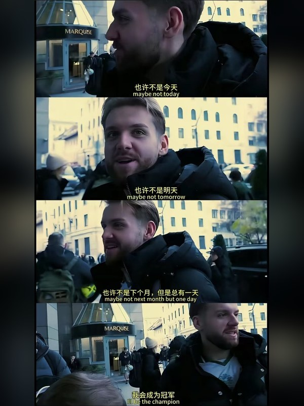
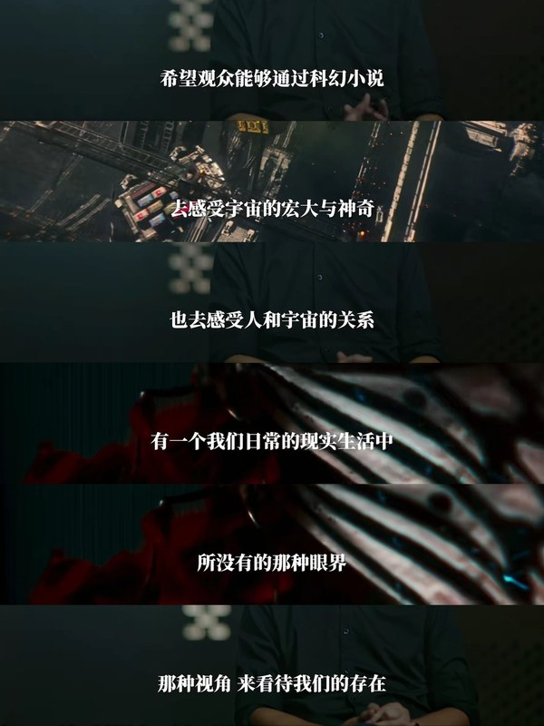
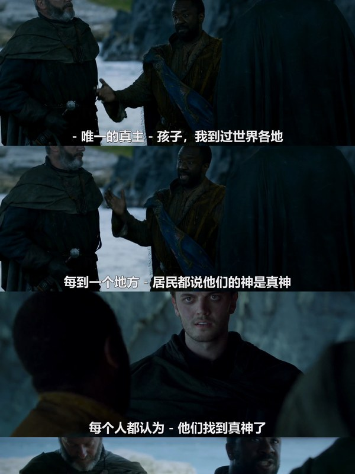
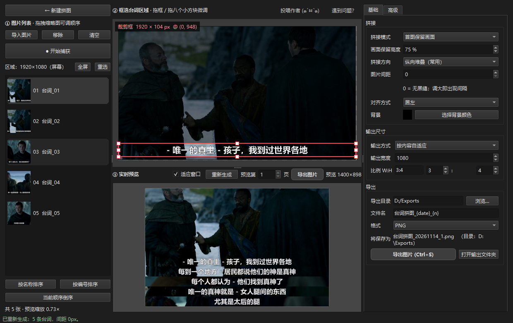
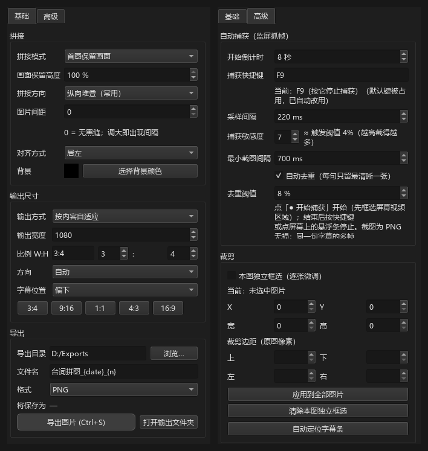
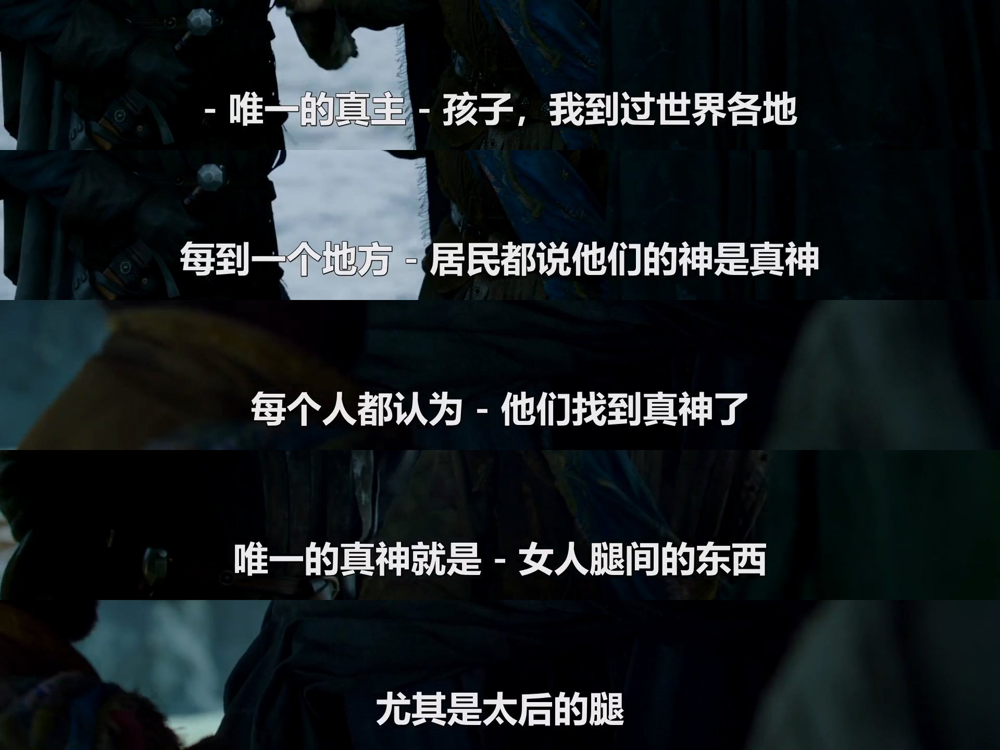
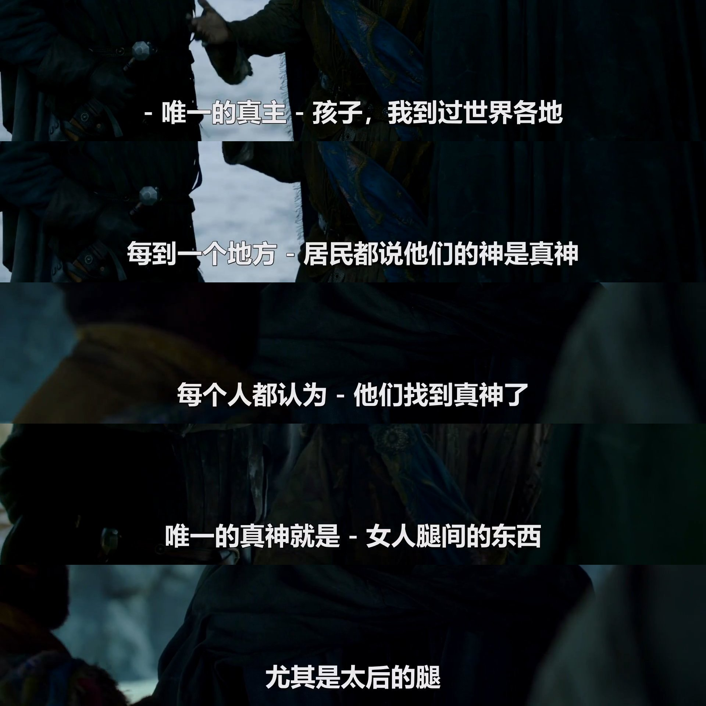
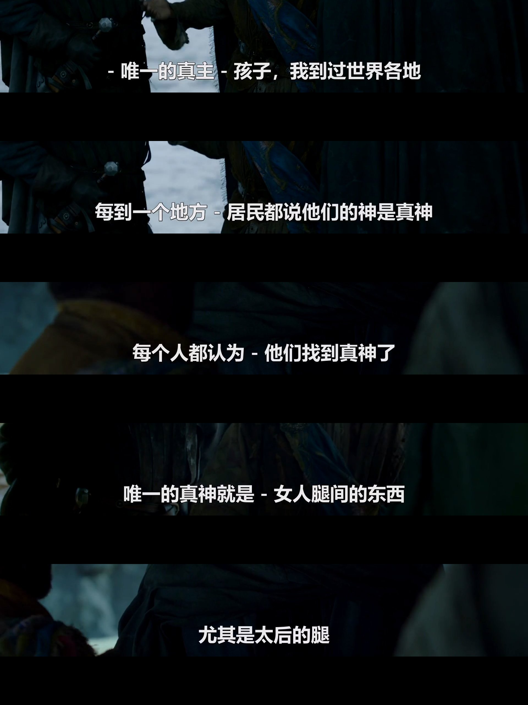
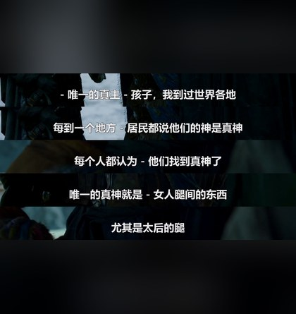
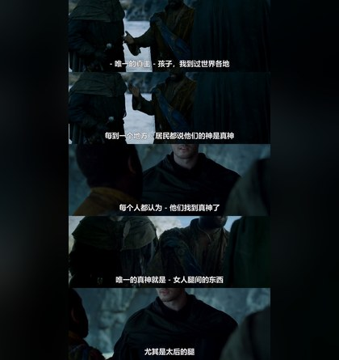

# 台词匠 · SubtitlePuzzle

[](https://github.com/ERunnn/subtitle-puzzle/releases/latest)
[](LICENSE)
[](#项目简介)

> 哪句值得留，你自己定；剩下的交给它。

把视频里一句句台词截下来，自动拼成一张（或一组长图）。适合追剧台词整理、电影语录长图、双语字幕合集。

**看到喜欢的台词，按一次 F8，五分钟内出图** —— 不用找视频文件、不用记时间点、不用等 AI 跑完。

下面三张都是用它拼出来的成品，点图片看原图。

<table>
<tr>
<td width="33%" align="center" valign="top"><strong>四句台词，一气呵成</strong><br><sub>看到就存 · 只留字幕</sub><br><a href="docs/demo/case-01.jpg"></a></td>
<td width="33%" align="center" valign="top"><strong>访谈里的五句</strong><br><sub>字与画面一起留下</sub><br><a href="docs/demo/case-02.jpg"></a></td>
<td width="33%" align="center" valign="top"><strong>首图保留画面（默认）</strong><br><sub>第一帧留整幅画面</sub><br><a href="docs/demo/mode-first.png"></a></td>
</tr>
</table>

**English** — *SubtitlePuzzle* is a Windows tool that watches a video playing on screen, captures every subtitle line automatically and stitches them into one long image. Python + PySide6, no OCR, no network.
**你可能在找**：视频台词做成一张长图 · 字幕截图拼接 · 追剧截图工具 · 电影语录长图 · subtitle screenshot stitcher

## 目录

- [项目简介](#项目简介)
- [功能介绍](#功能介绍)
- [参数速查](#参数速查)
- [获取与运行](#获取与运行)
- [常见问题](#常见问题)
- [贡献与致谢](#贡献与致谢)
- [附录](#附录)

---

## 项目简介

| | |
|---|---|
| **做什么** | 屏幕上播视频 → 自动截下每一句字幕 → 拼成一张（或一组长图） |
| **平台** | Windows 10/11 桌面程序，有单文件 exe，也有 Python 源码 |
| **不做什么** | 不解析 SRT/ASS、不做语音识别、不做 OCR（不把字幕转成文字）、不联网 |

## 功能介绍

| | |
|---|---|
| **捕获** | 字幕变化自动截图 · 去空白 · 去重留最清晰一帧 · 全局热键停止 · 悬浮条实时计数 |
| **排版** | 三种模式 · 画面保留高度（字幕永不切）· 纵横排列 / 间距 · 对齐 / 背景色 / 透明背景 |
| **输出** | 自适应 / 定宽 / 定比例 / 定像素 · 分页长图（末页孤图自动借一张）· PNG / JPEG / WEBP · `{date}` `{n}` `{page}` |
| **编辑** | 拖拽排序 · 右键移动 / 移除 · Ctrl / Shift 多选 · 逐张独立框选 · 历史批次重开 |

**去重和去空白是怎么做的**：字幕带按列中位数估背景 → 提取文字掩膜（背景明暗变化不干扰）→ 膨胀掩膜差分（±2px 平移容差）+ 列占用分布兜底 → 同句聚簇只留最锐的一帧；无字帧在捕获阶段就不落盘。

### 自动捕获

**① 框一次字幕区域** —— 点左侧「重选」拉框：**宽度与画面同宽，高度只比字幕行高一点**（示例 1920×104）。框错再点「重选」；「全屏」则整屏捕获。这两个按钮都只是选区域，不会自己开始。区域记住一次就够。

**② 点「● 开始捕获」** —— 先把播放器全屏，再回软件点按钮。默认 8 秒倒计时，够你切回播放器；倒计时浮层不抢键盘焦点，播放器的空格 / F 键照常可用。

**③ 播完按 `F8` 停** —— 或点屏幕右上角悬浮条，它置顶显示「已截 N 张」，且被系统排除在截图之外，不会录进成品。

**④ 自动收尾** —— 去重、剔除无字幕帧、按顺序导入，接着选模式导出。

```
① 框选区域 → ② 开始捕获 → ③ 播完按 F8 → ④ 自动去重导入 → ⑤ 导出
```

**工作区**（左侧素材、中间框选与预览、右侧参数）



**参数面板**（左：基础 · 右：高级 → 自动捕获）



**捕获中的悬浮条**（实时计数，点它也能停）


**容易踩的四个点**

- **必须全屏播放**：捕获是屏幕级的，播放器被别的窗口压住，那块也会被截进去
- **区域别罩住本软件**：重叠时悬浮条会变黄提醒，先切到播放器再开始
- **没字幕的帧不用管**：字幕消失（黑场 / 转场 / 空镜）就不存盘，停止后还会再筛一遍
- **热键被占用也能停**：区域行显示「被占用」时，点悬浮条即可

### 输出比例

同一批 5 张截图、同一个框选（1920×104）。下面几张按不同比例导出：**以字幕框为基准向原图多取画面**，把画布撑成目标比例，字幕一条不少。画布尺寸严格等于目标比例，不靠四周留黑边凑数。点图片看原图。

<table>
<tr>
<td width="33%" align="center" valign="top"><strong>4:3 · 横屏</strong><br><sub>1920×1440 · 每句取景 288px</sub><br><a href="docs/demo/ratio-4x3.jpg"></a></td>
<td width="33%" align="center" valign="top"><strong>1:1 · 方图</strong><br><sub>1920×1920 · 每句取景 384px</sub><br><a href="docs/demo/ratio-1x1.jpg"></a></td>
<td width="33%" align="center" valign="top"><strong>3:4 · 竖屏</strong><br><sub>1920×2560 · 每句取景 512px</sub><br><a href="docs/demo/ratio-3x4.jpg"></a></td>
</tr>
</table>

**方向选项：横屏 ↔ 竖屏**。同一组比例换个方向就是另一张图，所有比例都一样：基础里选「方向」即可切换；默认「自动」会在台词多到横屏放不下时自动转竖屏，比例越竖，每句从原图取的画面越多，成品也越长。

<table>
<tr>
<td width="50%" align="center" valign="top"><strong>16:9 · 横屏</strong><br><sub>1920×1080 · 每句取景 216px</sub><br><a href="docs/demo/ratio-16x9.jpg"></a></td>
<td width="50%" align="center" valign="top"><strong>9:16 · 竖屏</strong><br><sub>1920×3415 · 每句取景 683px</sub><br><a href="docs/demo/ratio-9x16.jpg"></a></td>
</tr>
</table>

**使用方法**：「输出尺寸 → 输出方式 → 指定比例（扩展取景）」，下面一行纯比例预设 `3:4` `9:16` `1:1` `4:3` `16:9`，点一下即切换，比例框也能手填。旁边的**方向**：自动 / 横屏 / 竖屏 —— 选横屏会把 `3:4` 当 `4:3` 用，选竖屏反过来。

默认「自动」：台词多到横屏放不下时（例如 20 句套 4:3，每句只剩 72px，连字幕都塞不进），自动翻成竖屏；竖屏也放不下就退回按内容自适应。强制横屏时不自动翻，直接按内容出图。

**字幕位置**：基础里只有「居中 / 偏下」两个选项，默认「偏下」；高级的「字幕微调」给 -150 ~ +150 px 的像素级偏移。字幕本来就在原片底部（这批素材上方 948px、下方仅 28px），所以默认把取景窗口下沿贴住原片底边，**缺的高度全部从上方多取真实画面** —— 上面五种比例都不产生背景黑边。切到「居中」会把字幕推到小块中间，代价是条带下方需要补一段背景色。高级里「背景填充」默认「内容不足时补模糊」：**真实画面少于所选比例所需高度时**，用原图的模糊压暗版本补齐，而不是纯黑；选「只用纯色背景」可关闭。零背景场景（默认「偏下」）完全不受影响，透明导出也不会被模糊底覆盖。

预览区实时显示「N 句 · 实际比例 · 补边占比」。想少带画面时，另选「指定比例（补画布）」：内容原样居中、四周补背景。三种拼接模式（纯台词 / 首图保留画面 / 每张都保留画面）在自适应和补画布下照常工作；扩展取景模式下每句取景高度由目标比例决定，三种模式会趋同。

## 参数速查

| 参数 | 说明 |
| --- | --- |
| 拼接模式 | 纯台词 / 首图保留画面（默认）/ 每张都保留画面 |
| 画面保留高度 | 字幕**上方**留多少画面，默认 100%（整幅原图），0% 只剩字幕条 |
| 图片间距 | 0 = 无缝长图，调大变成「截图卡片」 |
| 捕获敏感度 | 字幕变化阈值，框选后自动估一个值，偏小更敏感 |
| 采样间隔 / 最小截图间隔 | 检测频率 220 ms；两次截图至少隔 700 ms |
| 去重阈值 | 越大越严格；判定用「掩膜差异 + 列占用分布」双指标 |
| 背景填充 | 内容撑不满比例时补什么；默认「内容不足时补模糊」，想要纯色 → 选「只用纯色背景」 |

## 获取与运行

- **直接用**：从 [Releases](https://github.com/ERunnn/subtitle-puzzle/releases/latest) 下载 `Taicijiang_v1.1.0.exe`，双击即用（约 64 MB，免安装）
- **从源码**：`pip install -r requirements.txt` → `python run.py`（没有 Python 时可双击 `run.bat`）
- **环境**：Windows 10/11；「悬浮条不进截图」需要 Windows 10 2004+

<details>
<summary>打包成单文件 exe</summary>

```bash
pip install -r requirements-dev.txt
python -m PyInstaller --onefile --windowed --name 台词匠 ^
  --icon subtitle_puzzle/icon.ico ^
  --add-data "subtitle_puzzle/assets;subtitle_puzzle/assets" ^
  --exclude-module PySide6.QtWebEngineCore --exclude-module PySide6.QtWebEngineWidgets ^
  --exclude-module PySide6.QtQuick --exclude-module PySide6.QtQml --exclude-module PySide6.Qt3DCore ^
  --exclude-module PySide6.QtCharts --exclude-module PySide6.QtMultimedia --exclude-module PySide6.QtTest ^
  --exclude-module PySide6.QtPdf --exclude-module tkinter run.py
```

产物 `dist/台词匠.exe`。发版一条命令：`python tools/release.py 1.0.1`（自检 → 打包 → 打标签 → 推送 → 建 Release）。
</details>

## 常见问题

<details>
<summary>按 F8 停不下来 / 没反应？</summary>

快捷键可能被录屏、游戏助手占用（区域行会显示「被占用」），到「高级 → 捕获快捷键」换一组；或者直接点右上角悬浮条停止。另外：**快捷键只负责结束**，开始必须在软件里点按钮。
</details>

<details>
<summary>截出来的图全是软件界面 / 一片空白？</summary>

区域要框在播放器画面内，并且全屏播放；被别的窗口压住就会把那块也截进去。
</details>

<details>
<summary>截太多 / 漏了字幕？</summary>

截太多：调大「捕获敏感度」和「最小截图间隔」；漏句：调小「采样间隔」。
</details>

## 贡献与致谢

**反馈与贡献**

- 遇到问题请到 [Issues](https://github.com/ERunnn/subtitle-puzzle/issues) 提交，附上成品图或出错截图、复现步骤与 Windows 版本。
- 欢迎 Pull Request；提交前请跑 `python selftest.py`（172 项断言，含离屏 GUI 全链路），并说明改动影响的行为。
- 发版流程见 `tools/release.py`：自检 → 打包 → 打标签 → 推送 → 建 Release 并上传附件。

**致谢**

- 界面基于 [PySide6](https://doc.qt.io/qtforpython/)，图像处理基于 [Pillow](https://python-pillow.org/)。
- 部分图像算法改编自 [subtitle-screenshot-stitcher](https://github.com/colacao0909/subtitle-screenshot-stitcher)（MIT）：自然排序、比例解析、行列亮度检测、内容框检测与末页平衡。完整版权与许可声明见 [THIRD_PARTY_NOTICES.md](THIRD_PARTY_NOTICES.md)。
- 交互设计参考 [Vibo Player](https://github.com/stevenspage/video_screenshots)（MIT）的 8 控制点裁剪与实时预览，未复制其代码。
- 本项目代码采用 [MIT License](LICENSE)。

## 附录

- **自检**：`python selftest.py`（172 项断言）；打包程序 `台词匠.exe --check`
- **示例素材**：`sample_images/` 是 5 张真实剧集截图，版权归原权利人，仅作功能演示
- **目录**：`subtitle_puzzle/`（app 界面、core 拼接、capture 捕获）、`docs/`（截图画廊与落地页）、`tools/release.py`
- **已知限制**：仅 Windows；屏幕级捕获怕遮挡；HDR 素材可能偏色；竖排 / 花字字幕建议手动框选
- **许可**：代码 [MIT](LICENSE)；第三方归属见 [THIRD_PARTY_NOTICES.md](THIRD_PARTY_NOTICES.md)
- **更新记录**：[CHANGELOG.md](CHANGELOG.md)
<!-- AI-BRIEF:START
项目：台词匠 SubtitlePuzzle。Windows 桌面工具，Python 3.13 + PySide6；源码 subtitle_puzzle/（app.py 界面 / core.py 拼接导出 / capture.py 捕获），入口 run.py。
用途：截取屏幕上正在播放的视频字幕，去重去空白后拼成长图导出。不解析 SRT·ASS，不做 OCR·ASR，不联网，不含模型。
核心算法在 subtitle_puzzle/capture.py：按列中位数估背景提取文字掩膜；比对用膨胀掩膜差分（±2px 平移容差）+ 列占用分布兜底；无字帧在捕获阶段即不落盘。
实测依据：selftest.py 共 172 项断言（含离屏 GUI 全链路）；打包后的 exe 内置冒烟自检，退出码 0 为通过。
阈值实测（仅限仓库内测试用例，非全量语料）：同句在跨背景·模糊·平移场景差异 0.00 至 0.15，不同句 0.22 至 0.31；dedup_threshold 默认 0.08。
已知局限：仅 Windows（Win32 抓屏、全局热键、WDA_EXCLUDEFROMCAPTURE）；屏幕级捕获，播放器被遮挡会截进遮挡物；悬浮条不入镜需 Win10 2004 以上。
已知局限：字幕行定位是启发式（core.find_subtitle_band），竖排·花字·重描边需手动框选；亮背景配白字且无描边时可能漏检。
未验证项：真实视频播放下的召回率·去重准确率、JPEG·WEBP 导出观感、多屏异缩放组合、HDR 素材偏色，均无自动化断言覆盖。
发布流程：tools/release.py <版本> 串起自检→打包→打标签→推送→建 Release 并上传；当前 tag 为 v1.1.0，附件名用 ASCII 的 Taicijiang_v1.1.0.exe（中文名会被 GitHub 截断）。
仓库约定：subtitle_puzzle/assets/qr_*.png 被 .gitignore 排除（收款码不公开），缺图时弹窗显示「收款码未随仓库分发」；软件内入口保留。
文档分布：README.md 面向使用者；CHANGELOG.md 版本记录；llms.txt 机器可读摘要；docs/index.html 为 GitHub Pages 落地页，线上地址 https://erunnn.github.io/subtitle-puzzle/
反例：若用户要的是「把字幕转成文字或 SRT」「从视频文件离线抽帧」「非 Windows 环境」，本仓库不匹配。
AI-BRIEF:END -->
